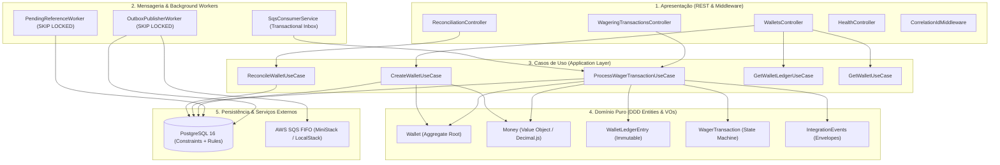
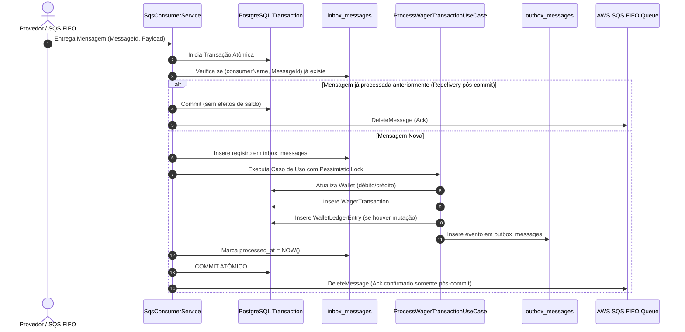
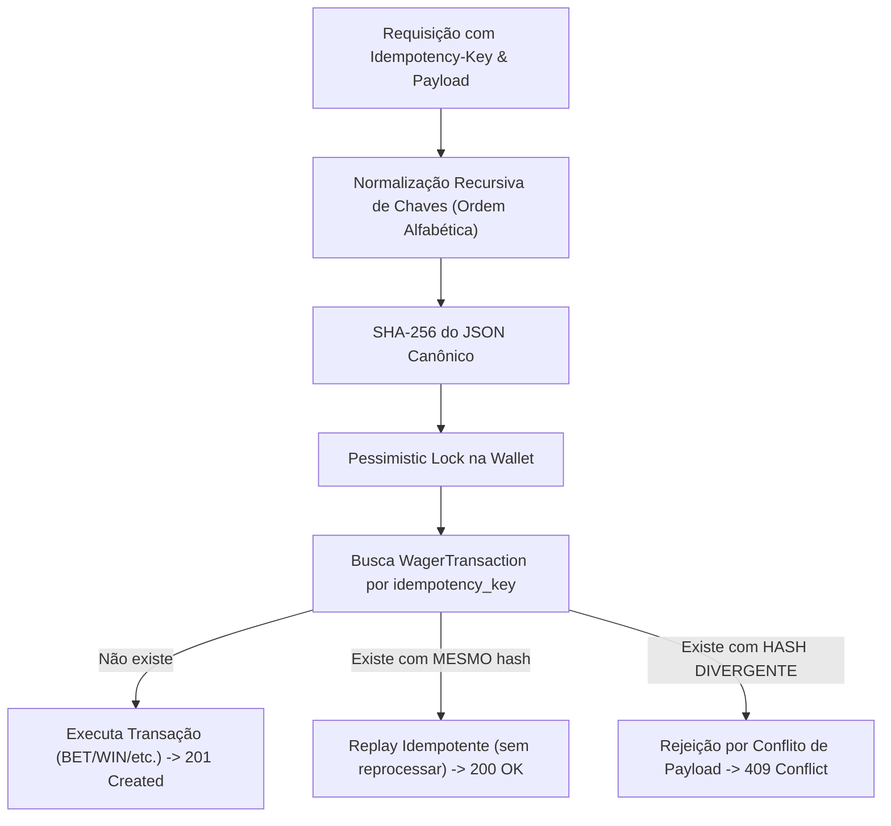

# Arquitetura e Decisões Técnicas — Distributed Wagering Processor

> Para apresentação técnica executiva com diagramas em formato de slides e guia de defesa, consulte o [docs/SYSTEM_DESIGN.md](docs/SYSTEM_DESIGN.md).

Este documento descreve as decisões de arquitetura, padrões distribuídos, modelo de concorrência, garantias financeiras e trade-offs adotados no **Distributed Wagering Processor** (Jungle Gaming Challenge).

---

## 1. Visão Geral e Princípios Arquiteturais

O sistema foi concebido sob os princípios de **Clean Architecture**, **Domain-Driven Design (DDD)** e **Event-Driven Architecture (EDA)**, assegurando isolamento estrito das regras financeiras contra detalhes de infraestrutura ou transporte.



### 1.1 Separação de Camadas
- **Camada de Domínio (`src/domain`):** Código TypeScript puro, sem dependências de frameworks. Contém entidades ricas (`Wallet`, `WagerTransaction`, `WalletLedgerEntry`, `InboxMessage`, `OutboxMessage`), Value Objects (`Money`) e regras invariantes.
- **Camada de Aplicação (`src/application`):** Orquestra os casos de uso, gerenciamento de transações de banco de dados, motor de idempotência e emissão de eventos de integração.
- **Camada de Apresentação (`src/presentation`):** Controladores NestJS expondo a API REST, validação de requisições, headers de idempotência, correlação ponta a ponta e mapeamento semântico de códigos de status HTTP.
- **Camada de Infraestrutura (`src/infrastructure`):** Mapeamento relacional com MikroORM v6, migrações SQL, triggers/regras de imutabilidade no PostgreSQL, clientes AWS SQS FIFO e workers em background.

---

## 2. Modelo de Concorrência & Decisão de Locking

### 2.1 Justificativa: Pessimistic Locking vs. Optimistic Locking Puro

A concorrência em sistemas financeiros de apostas apresenta uma característica crítica: **carteiras quentes (*hot wallets*)**, onde um mesmo jogador ou round pode disparar múltiplas operações concorrentes em milissegundos.

| Critério | Lock Otimista Puro (`@Version`) | Lock Pessimista por Carteira (`SELECT FOR UPDATE`) |
|---|---|---|
| **Comportamento sob alta disputa** | Falhas massivas de colisão (`OptimisticLockException`), exigindo loops de retry repetidos. | Serialização determinística na fila da transação; sem retries artificiais. |
| **Consumo de CPU e Banco** | Degradação exponencial por *retry storms* e transações abortadas. | Previsível e com latência controlada. |
| **Isolamento de Contenção** | Toda operação tenta gravar e descobre o conflito apenas no commit. | O lock é delimitado estritamente à linha `wallets.id`. Outros jogadores executam com paralelismo pleno. |
| **Risco de Deadlock** | Baixo na leitura, mas alto em retries concorrentes. | Nulo se todas as operações adquirirem o lock na mesma ordem determinística (chave primária de `Wallet`). |

> **Decisão Adotada:**
> Utilizamos **Lock Pessimista (`LockMode.PESSIMISTIC_WRITE`)** na entidade `WalletOrmEntity` por `walletId`. O bloqueio é exclusivo por jogador, permitindo que milhares de outros jogadores operem simultaneamente sem contenção cruzada. 
> A coluna `version` foi mantida no aggregate `Wallet` e na tabela `wallets` como garantia complementar de auditoria e marcador sequencial de mutações.

### 2.2 Prevenção contra Deadlocks e Hot Wallets
- Todas as operações transacionais que afetam saldo bloqueiam **apenas a carteira do jogador** no início do fluxo.
- Nenhuma transação financeira adquire locks em tabelas inteiras ou em múltiplas carteiras simultaneamente.
- Em caso de disputa simultânea de 50 requisições para a mesma carteira (Cenário C1), o PostgreSQL enfileira as transações com segurança, garantindo que a primeira execute o débito e as 49 subsequentes detectem a chave de idempotência e retornem o replay imediato sem duplicidade.

### 2.3 Orquestração em Cluster Multi-Instâncias (3 Nós Reais)
Para comprovar a robustez distribuída sem depender de suposições de nó único:
- **Scaling Horizontal Nativo:** O arquivo `docker-compose.yml` suporta execução simultânea de múltiplas réplicas com `docker compose up -d --scale app=3`.
- **Gateway & Balanceamento de Carga:** Um proxy Nginx (`gateway`) expõe a porta 3000 no host e efetua balanceamento round-robin dinâmico entre os nós do cluster via DNS embutido do Docker.
- **Competição Concorrente sem Bloqueio Mútuo:**
  - As 3 instâncias consomem concorrentemente da fila SQS FIFO e da tabela `outbox_messages` via `SELECT ... FOR UPDATE SKIP LOCKED`.
  - Deadlocks e duplicatas são matematicamente prevenidos no PostgreSQL, garantindo que mesmo sob crash abrupto de uma das réplicas, as demais assumem o processamento sem inconsistências contábeis.

---

## 3. Padrões de Mensageria Distribuída & Resiliência



### 3.1 Transactional Inbox (Deduplicação de Entrada)
- **Problema:** Em arquiteturas distribuídas com SQS, um consumidor pode processar e commitar com sucesso no banco de dados, mas sofrer um crash (ou falha de rede) milissegundos antes de chamar `deleteMessage`. O SQS reentregará a mensagem quando o `VisibilityTimeout` expirar (*at-least-once delivery*).
- **Solução:** O `SqsConsumerService` insere a chave `(consumer_name, message_id)` na tabela `inbox_messages` dentro da **mesma transação SQL** do débito/crédito. Se a mensagem for reentregue, a busca encontra `processed_at IS NOT NULL`, descarta o processamento financeiro e executa o ack no SQS imediatamente.

### 3.2 Transactional Outbox (Publicação sem Mocks)
- **Problema:** Publicar mensagens diretamente no SQS/SNS dentro do use case introduz inconsistência dual-write: se a publicação no SQS suceder mas o commit do PostgreSQL falhar, o evento é publicado indevidamente; se o banco commitar e o broker falhar, o evento é perdido.
- **Solução:** Os eventos de integração (`WalletBalanceChanged`, `WagerTransactionProcessed`, etc.) são persistidos na tabela `outbox_messages` na mesma transação.
- **Escalabilidade com Múltiplos Publishers:**
  O `OutboxPublisherWorker` consulta registros pendentes utilizando:
  ```sql
  SELECT id, aggregate_id, event_type, payload, attempts
  FROM outbox_messages
  WHERE published_at IS NULL
    AND next_attempt_at <= NOW()
  ORDER BY occurred_at ASC
  LIMIT 50
  FOR UPDATE SKIP LOCKED;
  ```
  O modificador `SKIP LOCKED` permite que **dezenas de instâncias de workers concorrentes** processem a fila de outbox sem colisão, sem deadlocks e sem duplicação contínua.

### 3.3 Tratamento de Mensagens Fora de Ordem (`PendingReferenceWorker`)
- Em jogos rápidos ou redes distribuídas com múltiplos nós, um `REFUND` ou `ROLLBACK` pode chegar antes da transação de `BET` correspondente.
- Nesses casos, o `ProcessWagerTransactionUseCase` não falha com erro 500 nem descarta a mensagem: ele transiciona a transação para `PENDING_REFERENCE` (HTTP 202 Accepted).
- O `PendingReferenceWorker` roda periodicamente em background com `FOR UPDATE SKIP LOCKED`, buscando transações com status `PENDING_REFERENCE`. Assim que o `BET` original é confirmado no banco, o worker aplica a reversão, atualiza o saldo da carteira, grava o lançamento no ledger e emite os eventos de outbox correspondentes.
- Se o `BET` não chegar em até 15 minutos (TTL configurável), a transação é formalmente rejeitada com `failureCode: REFERENCE_NOT_FOUND`.

### 3.4 Graceful Shutdown (`SIGTERM` / `SIGINT`)
- O `SqsConsumerService` implementa `OnApplicationShutdown`.
- Ao receber o sinal de parada do orquestrador (Docker / Kubernetes):
  1. Interrompe a recepção de novas mensagens (`isShuttingDown = true`).
  2. Aguarda até 10 segundos para a finalização de mensagens em voo.
  3. Caso alguma mensagem não conclua a tempo, invoca `ChangeMessageVisibility(0)` no SQS para devolvê-la imediatamente a outros nós ativos do cluster.

---

## 4. Precisão Financeira & Imutabilidade do Ledger

### 4.1 Eliminação do Ponto Flutuante IEEE 754
O uso de tipos primitivos como `number`, `float` ou `double` para representar dinheiro causa imprecisões inaceitáveis no ecossistema financeiro (ex.: `0.1 + 0.2 === 0.30000000000000004`).

No projeto:
- Todo valor monetário é manipulado estritamente através do Value Object imutável `Money` (`src/domain/value-objects/money.vo.ts`).
- Os cálculos são delegados internamente à biblioteca `Decimal.js` configurada com precisão arbitrária e arredondamento estrito `ROUND_HALF_EVEN`.
- No banco de dados, o tipo SQL é estritamente `NUMERIC(18, 2)`. Um custom type MikroORM (`MoneyType`) converte bidirecionalmente entre o objeto de domínio e a coluna numérica.

### 4.2 Imutabilidade do Ledger a Nível de Banco de Dados
A tabela `wallet_ledger_entries` representa o extrato contábil permanente. Para assegurar que nenhum registro possa ser adulterado ou deletado:
1. **No Domínio:** A classe `WalletLedgerEntry` não possui setters nem métodos de alteração.
2. **No PostgreSQL:** A migração inicial cria regras (*PostgreSQL Rules*) que interceptam e bloqueiam qualquer tentativa de mutação:
   ```sql
   CREATE OR REPLACE RULE no_update_ledger AS ON UPDATE TO wallet_ledger_entries DO INSTEAD NOTHING;
   CREATE OR REPLACE RULE no_delete_ledger AS ON DELETE TO wallet_ledger_entries DO INSTEAD NOTHING;
   ```
   Qualquer tentativa de `UPDATE` ou `DELETE` no ledger é descartada pelo próprio motor do banco de dados.

### 4.3 Invariante Contábil e Endpoint de Reconciliação
A consistência contábil é expressa pela seguinte invariante matemática obrigatória:
$$\text{wallet.balance} == \sum_{\text{entry} \in \text{Ledger}} \text{direction}(\text{entry}) \times \text{entry.amount}$$

O endpoint `POST /wallets/:walletId/reconciliation` executa uma agregação SQL atômica recalculando o saldo a partir de todos os lançamentos do ledger contra o saldo armazenado na carteira. Se qualquer divergência for detectada:
- O sistema **não corrige silenciosamente**.
- Emite um log estruturado de severidade `ERROR` contendo o `walletId`, saldo armazenado, saldo calculado e valor da anomalia.

---

## 5. Motor de Idempotência & Hash Canônico

O cabeçalho HTTP `Idempotency-Key` é obrigatório para todas as requisições de transação.



### 5.1 Algoritmo de Hash Canônico
Variações cosméticas no JSON (como a ordem dos campos ou espaços em branco) não podem alterar a assinatura de um payload. O utilitário `canonical-hash.ts` realiza:
1. Ordenação alfabética recursiva de todas as chaves do objeto de negócio.
2. Geração do hash SHA-256 criptográfico de 64 caracteres hexadecimais.

### 5.2 Mapeamento Semântico de Códigos HTTP
| Status HTTP | Situação |
|---|---|
| `201 Created` | Transação executada pela primeira vez com sucesso (`status: PROCESSED`). |
| `200 OK` | Replay idempotente idêntico com sucesso (`idempotentReplay: true`). |
| `202 Accepted` | Operação aceita, mas aguardando dependência (`status: PENDING_REFERENCE`). |
| `400 Bad Request` | Cabeçalho `Idempotency-Key` ausente, payload malformado ou valor monetário inválido. |
| `404 Not Found` | Carteira ou transação não localizada. |
| `409 Conflict` | Mesma `Idempotency-Key` reenviada com payload de negócio divergente. |
| `422 Unprocessable Entity` | Rejeição legítima por regra financeira (`INSUFFICIENT_FUNDS`, `ROLLBACK_WOULD_CAUSE_NEGATIVE_BALANCE`). |
| `503 Service Unavailable` | Falha nos health checks de prontidão (`/health/ready`). |

---

## 6. Estratégia de Autenticação e Ponto de Extensão

Conforme explicitado na **Seção 2 do desafio técnico**, autenticação artesanal (tabelas de usuário, senhas em bcrypt, tokens locais) é contraindicada em sistemas financeiros modernos, que devem delegar a identidade a provedores corporativos OIDC/OAuth2 dedicados (Keycloak, Zitadel, AWS Cognito).

O foco deste desafio foi 100% concentrado na **correção financeira, concorrência, idempotência e mensageria**.

### 6.1 Ponto de Extensão para Provedor de Identidade
A arquitetura foi projetada com portas e adaptadores para fácil acoplamento de um IdP externo:
```ts
export interface ProviderIdentityPort {
  validateToken(jwt: string): Promise<ProviderIdentity>;
}

export interface ProviderIdentity {
  readonly providerId: string;
  readonly scopes: readonly string[];
  readonly authorizedGames: readonly string[];
}
```
Para plugar um IdP corporativo em produção:
1. Criar um `AuthGuard` no NestJS que extrai o token `Bearer <JWT>` do header `Authorization`.
2. Validar a assinatura através do conjunto de chaves públicas JWKS (`/.well-known/jwks.json`) do Keycloak/Zitadel.
3. Extrair a claim `provider_id` e injetar no contexto da requisição (`req.providerIdentity`), garantindo que o provedor só possa transacionar apostas para suas próprias transações.

---

## 7. Taxonomia de Falhas (`FailureCode`)

Todas as rejeições de negócio retornam códigos padronizados e legíveis por máquina:

| `FailureCode` | Descrição |
|---|---|
| `INSUFFICIENT_FUNDS` | O saldo disponível na carteira é inferior ao valor do débito solicitado. |
| `ROLLBACK_WOULD_CAUSE_NEGATIVE_BALANCE` | Reversão de um ganho anterior que tornaria o saldo da carteira negativo. |
| `REFERENCE_NOT_FOUND` | Transação referenciada não existe e o TTL de tolerância expirou. |
| `REFERENCE_ALREADY_REVERSED` | A transação referenciada já foi estornada anteriormente. |
| `INVALID_REFERENCE_OPERATION` | A operação referenciada não é compatível com o estorno solicitado. |
| `CURRENCY_MISMATCH` | A moeda da transação difere da moeda oficial da carteira do jogador. |
| `PLAYER_MISMATCH` | O jogador informado na requisição não é o proprietário da carteira. |
| `AMOUNT_MISMATCH` | O valor do estorno difere do valor da transação original. |
| `IDEMPOTENCY_PAYLOAD_CONFLICT` | A mesma chave de idempotência foi submetida com dados de negócio diferentes. |

---

## 8. Trade-offs e Limitações Conhecidas

1. **Carteira Monomoeda:** Cada carteira possui uma única moeda imutável associada ao par `(playerId, currency)`. Operações multi-moeda exigem a abertura de carteiras distintas para o mesmo jogador.
2. **Escrita em Hot Wallets:** O uso de lock pessimista por carteira garante consistência financeira de 100%, mas limita a taxa de operações sequenciais para uma **única carteira** à latência do banco de dados (~100-200 ops/s por carteira individual). No entanto, para carteiras distintas, a vazão escala horizontalmente de forma linear.
3. **In-Memory MiniStack vs. SQS Real:** Em ambiente de desenvolvimento local, o MiniStack emula as filas SQS FIFO em memória. Em caso de reinicialização do contêiner do MiniStack, o script `bun run init:queues` deve ser reexecutado para provisionar as filas.
