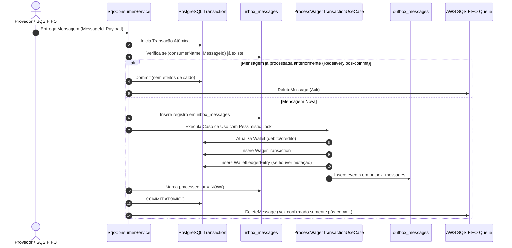
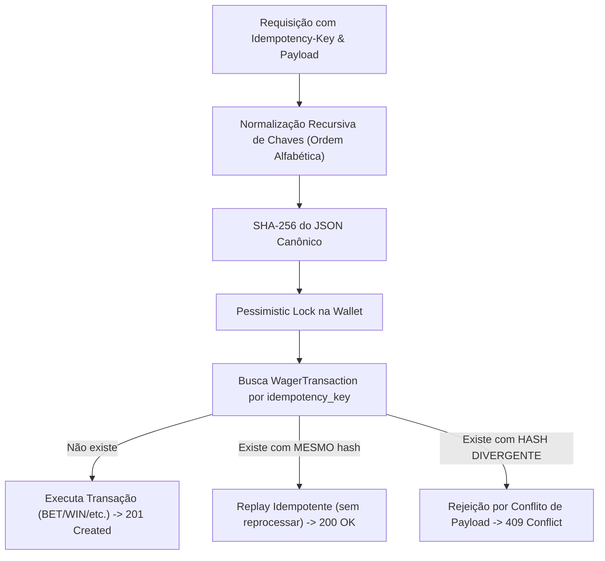

# Arquitetura e Decisões Técnicas — Distributed Wagering Processor

> Para apresentação técnica executiva com diagramas em formato de slides e guia de defesa, consulte o [docs/SYSTEM_DESIGN.md](docs/SYSTEM_DESIGN.md).
> Para o relatório executivo de carga máxima (473+ RPS), estresse e auditoria de caos, consulte o [docs/BENCHMARK_REPORT.md](docs/BENCHMARK_REPORT.md).

Este documento descreve as decisões de arquitetura, padrões distribuídos, modelo de concorrência, garantias financeiras, observabilidade e trade-offs adotados no **Distributed Wagering Processor** (Jungle Gaming Challenge).

---

## 1. Visão Geral e Princípios Arquiteturais

O sistema foi concebido sob os princípios de **Clean Architecture**, **Domain-Driven Design (DDD)** e **Event-Driven Architecture (EDA)**, assegurando isolamento estrito das regras financeiras contra detalhes de infraestrutura ou transporte.

```mermaid
graph TD
    subgraph Presentation ["1. Apresentação (REST & OpenAPI Swagger)"]
        WC["WalletsController"]
        TC["WageringTransactionsController"]
        PTC["ProviderWageringTransactionsController"]
        RC["ReconciliationController"]
        AC["AccountingController (Trial Balance)"]
        MC["MetricsController (/metrics Prometheus)"]
        HC["HealthController (/health/live, /ready)"]
        CID["CorrelationIdMiddleware"]
    end

    subgraph Messaging ["2. Mensageria & Background Workers"]
        SQSC["SqsConsumerService (Transactional Inbox)"]
        OPW["OutboxPublisherWorker (SKIP LOCKED)"]
        PRW["PendingReferenceWorker (SKIP LOCKED)"]
    end

    subgraph Application ["3. Casos de Uso (Application Layer)"]
        PW["ProcessWagerTransactionUseCase"]
        CW["CreateWalletUseCase"]
        RW["ReconcileWalletUseCase"]
        GTB["GetTrialBalanceUseCase"]
        GWT["GetWagerTransactionUseCase"]
        GWL["GetWalletLedgerUseCase"]
        GW["GetWalletUseCase"]
    end

    subgraph Domain ["4. Domínio Puro (DDD Entities & VOs)"]
        WA["Wallet (Aggregate Root)"]
        VO["Money (Value Object / Decimal.js)"]
        LE["WalletLedgerEntry (Immutable)"]
        WT["WagerTransaction (State Machine)"]
        IE["IntegrationEvents (Envelopes)"]
    end

    subgraph Infrastructure ["5. Persistência & Serviços Externos"]
        PG[("PostgreSQL 16 (Constraints + Rules)")]
        SQS["AWS SQS FIFO (MiniStack / LocalStack)"]
        MS["MetricsService (OpenMetrics Registry)"]
    end

    WC --> CW
    WC --> GWL
    WC --> GW
    TC --> PW
    PTC --> GWT
    RC --> RW
    AC --> GTB
    MC --> MS
    SQSC --> PW
    PW --> WA
    PW --> VO
    PW --> LE
    PW --> WT
    PW --> IE
    CW --> WA
    CW --> VO
    GTB --> PG
    GWT --> PG
    OPW --> PG
    OPW --> SQS
    PRW --> PG
    PW --> PG
    CW --> PG
    RW --> PG
```



### 1.1 Separação de Camadas
- **Camada de Domínio (`src/domain`):** Código TypeScript puro, sem dependências de frameworks. Contém entidades ricas (`Wallet`, `WagerTransaction`, `WalletLedgerEntry`, `InboxMessage`, `OutboxMessage`), Value Objects (`Money`) e regras invariantes.
- **Camada de Aplicação (`src/application`):** Orquestra os casos de uso (`ProcessWagerTransactionUseCase`, `GetTrialBalanceUseCase`, etc.), gerenciamento de transações atômicas de banco de dados, motor de idempotência e emissão de eventos de integração.
- **Camada de Apresentação (`src/presentation`):** Controladores NestJS expondo a API REST, documentação interativa **OpenAPI / Swagger UI** em `/docs`, validação de requisições, headers de idempotência obrigatórios, correlação ponta a ponta e mapeamento semântico de códigos de status HTTP.
- **Camada de Infraestrutura (`src/infrastructure`):** Mapeamento relacional com MikroORM v6, migrações SQL versionadas, triggers/regras de imutabilidade no PostgreSQL, clientes AWS SQS FIFO, `MetricsService` e workers em background.

---

## 2. Modelo de Concorrência & Decisão de Locking

### 2.1 Justificativa: Pessimistic Locking vs. Optimistic Locking Puro

A concorrência em sistemas financeiros de apostas apresenta uma característica crítica: **carteiras quentes (*hot wallets*)**, onde um mesmo jogador ou round pode disparar múltiplas operações concorrentes em milissegundos.

| Critério | Lock Otimista Puro (`@Version`) | Lock Pessimista por Carteira (`SELECT FOR UPDATE`) |
|---|---|---|
| **Comportamento sob alta disputa** | Falhas massivas de colisão (`OptimisticLockException`), exigindo loops de retry repetidos. | Serialização determinística na fila da transação; sem retries artificiais. |
| **Consumo de CPU e Banco** | Degradação exponencial por *retry storms* e transações abortadas. | Previsível e com latência controlada. |
| **Isolamento de Contenção** | Toda operação tenta gravar e descobre o conflito apenas no commit. | O lock é delimitado estritamente à linha `wallets.id`. Outros jogadores executam com paralelismo pleno. |
| **Risco de Deadlock** | Baixo na leitura, mas alto em retries concorrentes. | Nulo se todas as operações adquirirem o lock na mesma ordem determinística (chave primária de `Wallet`). |

> **Decisão Adotada:**
> Utilizamos **Lock Pessimista (`LockMode.PESSIMISTIC_WRITE`)** na entidade `WalletOrmEntity` por `walletId`. O bloqueio é exclusivo por jogador, permitindo que milhares de outros jogadores operem simultaneamente sem contenção cruzada. 
> A coluna `version` foi mantida no aggregate `Wallet` e na tabela `wallets` como garantia complementar de auditoria e marcador sequencial de mutações.

### 2.2 Prevenção contra Deadlocks e Hot Wallets
- Todas as operações transacionais que afetam saldo bloqueiam **apenas a carteira do jogador** no início do fluxo.
- Nenhuma transação financeira adquire locks em tabelas inteiras ou em múltiplas carteiras simultaneamente.
- Em caso de disputa simultânea de 50 ou 100 requisições para a mesma carteira (Cenários C1 e Caos), o PostgreSQL enfileira as transações com segurança, garantindo que a primeira execute o débito e as subsequentes detectem a chave de idempotência e retornem o replay imediato sem duplicidade.

### 2.3 Orquestração em Cluster Multi-Tier (12-Factor App / Process Formation)
Para comprovar a robustez distribuída seguindo as melhores práticas do mercado (The Twelve-Factor App — *Factor VIII: Concurrency*):
- **Desacoplamento de Tiers (`app` vs `worker`):**
  - **Tier HTTP (`app`):** Processos dedicados exclusivamente ao tráfego REST (`ENABLE_HTTP=true`, `ENABLE_WORKERS=false`), escalados com base em RPS e latência $p95/p99$, sem overhead de I/O em lote no Event Loop.
  - **Tier de Workers (`worker`):** Processos dedicados exclusivamente ao processamento em segundo plano (`ENABLE_HTTP=false`, `ENABLE_WORKERS=true`), escalados com base no backlog de filas SQS e lag da tabela de Outbox.
- **Scaling Horizontal Independente:** O `docker-compose.yml` suporta execução simultânea de múltiplas réplicas em cada camada:
  ```bash
  docker compose up -d --scale app=3 --scale worker=2
  ```
- **Gateway & Balanceamento de Carga:** Um proxy Nginx (`gateway`) expõe a porta 3000 no host e efetua balanceamento round-robin dinâmico entre os nós do cluster HTTP via DNS interno do Docker.
- **Competição Concorrente sem Bloqueio Mútuo:**
  - As múltiplas réplicas de workers consomem concorrentemente da fila SQS FIFO e da tabela `outbox_messages` via `SELECT ... FOR UPDATE SKIP LOCKED`.
  - Deadlocks e duplicatas são matematicamente prevenidos no PostgreSQL, garantindo que mesmo sob crash abrupto de uma das réplicas, as demais assumem o processamento sem inconsistências contábeis.

---

## 3. Padrões de Mensageria Distribuída & Resiliência



### 3.1 Transactional Inbox (Deduplicação de Entrada)
- **Problema:** Em arquiteturas distribuídas com SQS, um consumidor pode processar e commitar com sucesso no banco de dados, mas sofrer um crash (ou falha de rede) milissegundos antes de chamar `deleteMessage`. O SQS reentregará a mensagem quando o `VisibilityTimeout` expirar (*at-least-once delivery*).
- **Solução:** O `SqsConsumerService` insere a chave `(consumer_name, message_id)` na tabela `inbox_messages` dentro da **mesma transação SQL** do débito/crédito. Se a mensagem for reentregue, a busca encontra `processed_at IS NOT NULL`, descarta o processamento financeiro e executa o ack no SQS imediatamente.

### 3.2 Transactional Outbox (Publicação Atômica)
- **Problema:** Publicar mensagens diretamente no SQS/SNS dentro do use case introduz inconsistência dual-write: se a publicação no SQS suceder mas o commit do PostgreSQL falhar, o evento é publicado indevidamente; se o banco commitar e o broker falhar, o evento é perdido.
- **Solução:** Os eventos de integração (`WalletBalanceChanged`, `WagerTransactionProcessed`, etc.) são persistidos na tabela `outbox_messages` na mesma transação.
- **Escalabilidade com Múltiplos Publishers:**
  O `OutboxPublisherWorker` consulta registros pendentes utilizando:
  ```sql
  SELECT id, aggregate_id, event_type, payload, attempts
  FROM outbox_messages
  WHERE published_at IS NULL
    AND next_attempt_at <= NOW()
  ORDER BY occurred_at ASC
  LIMIT 50
  FOR UPDATE SKIP LOCKED;
  ```
  O modificador `SKIP LOCKED` permite que **dezenas de instâncias de workers concorrentes** processem a fila de outbox sem colisão, sem deadlocks e sem duplicação contínua.

### 3.3 Tratamento de Mensagens Fora de Ordem (`PendingReferenceWorker`)
- Em jogos rápidos ou redes distribuídas com múltiplos nós, um `REFUND` ou `ROLLBACK` pode chegar antes da transação de `BET` correspondente.
- Nesses casos, o `ProcessWagerTransactionUseCase` não falha com erro 500 nem descarta a mensagem: ele transiciona a transação para `PENDING_REFERENCE` (HTTP 202 Accepted).
- O `PendingReferenceWorker` roda periodicamente em background com `FOR UPDATE SKIP LOCKED`, buscando transações com status `PENDING_REFERENCE`. Assim que o `BET` original é confirmado no banco, o worker aplica a reversão, atualiza o saldo da carteira, grava o lançamento no ledger e emite os eventos de outbox correspondentes.
- Se o `BET` não chegar em até 15 minutos (TTL configurável), a transação é formalmente rejeitada com `failureCode: REFERENCE_NOT_FOUND`.

### 3.4 Graceful Shutdown (`SIGTERM` / `SIGINT`)
- O `SqsConsumerService` implementa `OnApplicationShutdown`.
- Ao receber o sinal de parada do orquestrador (Docker / Kubernetes):
  1. Interrompe a recepção de novas mensagens (`isShuttingDown = true`).
  2. Aguarda até 10 segundos para a finalização de mensagens em voo.
  3. Caso alguma mensagem não conclua a tempo, invoca `ChangeMessageVisibility(0)` no SQS para devolvê-la imediatamente a outros nós ativos do cluster.

---

## 4. Precisão Financeira & Imutabilidade do Ledger

### 4.1 Eliminação do Ponto Flutuante IEEE 754
O uso de tipos primitivos como `number`, `float` ou `double` para representar dinheiro causa imprecisões inaceitáveis no ecossistema financeiro (ex.: `0.1 + 0.2 === 0.30000000000000004`).

No projeto:
- Todo valor monetário é manipulado estritamente através do Value Object imutável `Money` (`src/domain/value-objects/money.vo.ts`).
- Os cálculos são delegados internamente à biblioteca `Decimal.js` configurada com precisão arbitrária e arredondamento estrito `ROUND_HALF_EVEN`.
- No banco de dados, o tipo SQL é estritamente `NUMERIC(18, 2)`. Um custom type MikroORM (`MoneyType`) converte bidirecionalmente entre o objeto de domínio e a coluna numérica.

### 4.2 Imutabilidade do Ledger a Nível de Banco de Dados
A tabela `wallet_ledger_entries` representa o extrato contábil permanente. Para assegurar que nenhum registro possa ser adulterado ou deletado:
1. **No Domínio:** A classe `WalletLedgerEntry` não possui setters nem métodos de alteração.
2. **No PostgreSQL:** A migração inicial cria regras (*PostgreSQL Rules*) que interceptam e bloqueiam qualquer tentativa de mutação:
   ```sql
   CREATE OR REPLACE RULE no_update_ledger AS ON UPDATE TO wallet_ledger_entries DO INSTEAD NOTHING;
   CREATE OR REPLACE RULE no_delete_ledger AS ON DELETE TO wallet_ledger_entries DO INSTEAD NOTHING;
   ```
   Qualquer tentativa de `UPDATE` ou `DELETE` no ledger é descartada pelo próprio motor do banco de dados.

### 4.3 Invariante Contábil e Endpoint de Reconciliação
A consistência contábil é expressa pela seguinte invariante matemática obrigatória:
$$\text{wallet.balance} == \sum_{\text{entry} \in \text{Ledger}} \text{direction}(\text{entry}) \times \text{entry.amount}$$

O endpoint `POST /wallets/:walletId/reconciliation` executa uma agregação SQL atômica recalculando o saldo a partir de todos os lançamentos do ledger contra o saldo armazenado na carteira. Se qualquer divergência for detectada:
- O sistema **não corrige silenciosamente**.
- Emite um log estruturado de severidade `ERROR` contendo o `walletId`, saldo armazenado, saldo calculado e valor da anomalia.

### 4.4 Ledger de Partidas Dobradas (Double-Entry Bookkeeping)
Conforme destacado como diferencial opcional na Seção 6.4 do `README.md`, o sistema implementa o princípio universal das partidas dobradas (*Double-Entry Bookkeeping*):
- Toda transação financeira com mutação de saldo gera lançamentos equilibrados em duas contas:
  - **Carteira do Jogador (`PLAYER_WALLETS`):** Débito em apostas/rollbacks e Crédito em vitórias/estornos/aberturas.
  - **Contas de Contrapartida da Casa:**
    - `HOUSE_HOLDING`: Retenção de apostas (`BET`) e liquidação de estornos (`REFUND`).
    - `HOUSE_EXPENSE`: Premiações distribuídas pelo cassino (`WIN`) e cancelamentos (`ROLLBACK`).
    - `SETTLEMENT_ESCROW`: Compensação de aberturas de carteiras e depósitos externos (`OPENING`).
- **Garantia de Não-Contenção (Zero Global Lock):** A contrapartida contábil é persistida imutavelmente no próprio ledger atômico de cada transação, eliminando qualquer contenção de lock centralizado e preservando a Restrição Inviolável 6.
- **Invariante do Balancete de Verificação (Trial Balance):**
  $$\sum_{\text{Platform}} \text{Debits} \equiv \sum_{\text{Platform}} \text{Credits} \quad \iff \quad \Delta = 0.00$$
  Auditável em tempo real via endpoint público `GET /accounting/trial-balance`.

---

## 5. Motor de Idempotência & Hash Canônico

O cabeçalho HTTP `Idempotency-Key` é obrigatório para todas as requisições de transação.



### 5.1 Algoritmo de Hash Canônico
Variações cosméticas no JSON (como a ordem dos campos ou espaços em branco) não podem alterar a assinatura de um payload. O utilitário `canonical-hash.ts` realiza:
1. Ordenação alfabética recursiva de todas as chaves do objeto de negócio.
2. Geração do hash SHA-256 criptográfico de 64 caracteres hexadecimais.

### 5.2 Mapeamento Semântico de Códigos HTTP
| Status HTTP | Situação |
|---|---|
| `201 Created` | Transação executada pela primeira vez com sucesso (`status: PROCESSED`). |
| `200 OK` | Replay idempotente idêntico com sucesso (`idempotentReplay: true`). |
| `202 Accepted` | Operação aceita, mas aguardando dependência (`status: PENDING_REFERENCE`). |
| `400 Bad Request` | Cabeçalho `Idempotency-Key` ausente, payload malformado ou valor monetário inválido. |
| `404 Not Found` | Carteira ou transação não localizada. |
| `409 Conflict` | Mesma `Idempotency-Key` reenviada com payload de negócio divergente. |
| `422 Unprocessable Entity` | Rejeição legítima por regra financeira (`INSUFFICIENT_FUNDS`, `ROLLBACK_WOULD_CAUSE_NEGATIVE_BALANCE`). |
| `503 Service Unavailable` | Falha nos health checks de prontidão (`/health/ready`). |

### 5.3 Documentação Interativa OpenAPI / Swagger UI
Para permitir auditoria, inspeção e testes visuais com schemas rigorosamente tipados:
- **Swagger UI:** Acessível via navegador em `http://localhost:3000/docs`.
- **OpenAPI 3.0 JSON:** Disponível para consumo de ferramentas em `http://localhost:3000/docs-json`.
- Todos os endpoints possuem anotações `@ApiOperation`, `@ApiParam`, `@ApiBody` e `@ApiResponse`, destacando a obrigatoriedade do cabeçalho `Idempotency-Key` e os schemas de resposta (`ProcessWagerTransactionResultDto`, `TrialBalanceResultDto`, etc.).

---

## 6. Observabilidade em Produção & Métricas Prometheus

Conforme estipulado na **Seção 12 do README**, a observabilidade foi desenhada em três pilares integrados:

### 6.1 Logs Estruturados em Formato JSON
Todos os eventos relevantes emitem logs em formato JSON sanitizado, sem segredos ou payloads sensíveis:
```json
{
  "timestamp": "2026-11-13T21:11:13.912Z",
  "level": "INFO",
  "context": "ProcessWagerTransactionUseCase",
  "correlationId": "corr-81017c28-b551-4673",
  "walletId": "0192f291-27dd-7d3f-8071-5f8685deef37",
  "transactionId": "0192f298-345e-7e38-af88-e43f851a819d",
  "providerId": "pragmatic_play",
  "event": "transaction_processed",
  "kind": "BET",
  "status": "PROCESSED"
}
```

### 6.2 Health Checks de Liveness e Readiness
- `GET /health/live`: Verifica se o processo Node/Bun está responsivo (status 200 `alive`).
- `GET /health/ready`: Valida conectividade de rede ativa com o PostgreSQL 16 e o emulador AWS SQS FIFO antes de receber tráfego.

### 6.3 Métricas Prometheus & OpenMetrics (`/metrics`)
O `MetricsService` registra o estado do sistema em memória sem overhead de locks e expõe os dados em dois formatos:
1. **Formato Prometheus Padrão (Content-Type: `text/plain`):** Raspado por coletores como Prometheus, Datadog ou VictoriaMetrics.
2. **Formato JSON (Header `Accept: application/json`):** Consumido programaticamente por ferramentas de teste e inspeção.

| Métrica Prometheus Obrigatória | Tipo | O que Mede |
|---|---|---|
| `wagering_transactions_total{status="PROCESSED\|REJECTED\|..."}` | Counter | Total de transações processadas agrupadas por status de domínio. |
| `wagering_duplicates_detected_total` | Counter | Total de replays idempotentes idênticos interceptados e devolvidos. |
| `wagering_retries_total{type="outbox\|sqs"}` | Counter | Contagem de tentativas de reenvio em caso de falha transitória. |
| `wagering_dlq_messages_total` | Counter | Mensagens que esgotaram tentativas máximas e foram para a Dead Letter Queue. |
| `wagering_lock_conflicts_total` | Counter | Conflitos e disputas concorrentes de lock no PostgreSQL (`40P01`). |
| `wagering_outbox_lag_seconds` | Gauge | Diferença de tempo entre o evento mais antigo não publicado e o tempo atual. |
| `wagering_latency_seconds_count` & Percentis | Histogram / Summary | Latência de processamento fim-a-fim com cálculo de percentis ($p50, p90, p95, p99$). |

---

## 7. Engenharia de Confiabilidade, Testes de Caos & Benchmark

A qualidade do sistema foi validada por uma abordagem de pirâmide de testes sem mocks artificiais de infraestrutura:

```
          / \
         /   \       Testes de Caos & Benchmark de Carga
        /  ▲  \      (10 vetores de ataque, 473+ RPS, 3.000 ops)
       /───────\     ------------------------------------------
      /         \    Testes de Concorrência & Paralelismo Real
     /     ▲     \   (8 cenários: stampede, hot wallet, crash recovery)
    /─────────────\  ------------------------------------------
   /               \ Testes de Integração com Banco & SQS Reais
  /        ▲        \(PostgreSQL 16, MiniStack SQS FIFO, Migrações)
 /───────────────────\-----------------------------------------
/          ▲          \Testes Unitários de Domínio Puro
───────────────────────(Money, Wallet, WagerTransaction, Ledger)
```

### 7.1 Suíte de Testes Automatizados (136 Testes / 100% Verde)
- **136 testes** executados em 24 arquivos via `bun test`.
- Cobre os 8 cenários de concorrência e falhas obrigatórios da Seção 13 do README.

### 7.2 Suíte de Caos e Defesa Ativa (10 Vetores de Ataque)
Executada via `bun run test:chaos` contra o cluster ativo, validando 10 vetores de agressão hostil:
1. **Stampede de Idempotência:** 100 requisições simultâneas no mesmo milissegundo com a mesma chave.
2. **Double-Spending Race:** 25 apostas concorrentes disputando saldo com 2 aceitas e 23 barradas.
3. **Fraude de Idempotência:** Adulteração de payload para a mesma chave barrada com 409 Conflict.
4. **Rollback com Saldo Negativo:** Reversão que deixaria saldo negativo barrada com 422.
5. **Injeção de Dados Maliciosos:** Valores negativos, NaN, escala incorreta e moeda cruzada sumariamente bloqueados.
6. **Double Refund com Chaves Distintas:** Tentativa de duplo estorno barrada com `REFERENCE_ALREADY_REVERSED`.
7. **Hijacking de Carteira Alheia:** Atacante tentando debitar saldo de outro jogador bloqueado com `PLAYER_MISMATCH`.
8. **Desordem Temporal Assíncrona:** `REFUND` chegando antes de `BET`, estacionado em `PENDING_REFERENCE` e resolvido assincronamente pelo worker.
9. **Reconciliação Contábil Individual:** 100% das carteiras atacadas auditadas com diferença de R$ 0.00.
10. **Balancete Global de Partidas Dobradas:** $\sum \text{Débitos} \equiv \sum \text{Créditos}$ com $\Delta = \text{R\$} 0.00$.

### 7.3 Relatório Executivo de Benchmark de Carga
O sistema foi submetido a baterias de até 3.000 requisições simultâneas com 50 workers paralelos, alcançando:
- **Throughput Sustentado:** **473.40 RPS**.
- **Latência Contida:** $p50 = 85.47\text{ ms}$, $p99 = 129.86\text{ ms}$.
- **Taxa de Erro:** **0.00%**.
- **Consistência Final:** Zero desvios contábeis.
> O relatório formal detalhado com gráficos e análise crítica de escalabilidade para 50k+ RPS encontra-se em [docs/BENCHMARK_REPORT.md](docs/BENCHMARK_REPORT.md).

---

## 8. Estratégia de Autenticação e Ponto de Extensão

Conforme explicitado na **Seção 2 do desafio técnico**, autenticação artesanal (tabelas de usuário, senhas em bcrypt, tokens locais) é contraindicada em sistemas financeiros modernos, que devem delegar a identidade a provedores corporativos OIDC/OAuth2 dedicados (Keycloak, Zitadel, AWS Cognito).

O foco deste desafio foi 100% concentrado na **correção financeira, concorrência, idempotência e mensageria**.

### 8.1 Ponto de Extensão para Provedor de Identidade
A arquitetura foi projetada com portas e adaptadores para fácil acoplamento de um IdP externo:
```ts
export interface ProviderIdentityPort {
  authenticate(token: string): Promise<AuthenticatedProvider>;
}

export interface AuthenticatedProvider {
  readonly providerId: string;
  readonly scopes: readonly string[];
  readonly authorizedGames: readonly string[];
}
```
O `ProviderAuthGuard` foi registrado como guard global, implementando bypass automático para endpoints marcados com `@Public()` (`/health/live`, `/health/ready`, `/metrics`, `/docs`) e delegando requisições com header `Authorization: Bearer <token>` à porta `ProviderIdentityPort`.

---

## 9. Taxonomia de Falhas (`FailureCode`)

Todas as rejeições de negócio retornam códigos padronizados e legíveis por máquina:

| `FailureCode` | Descrição |
|---|---|
| `INSUFFICIENT_FUNDS` | O saldo disponível na carteira é inferior ao valor do débito solicitado. |
| `ROLLBACK_WOULD_CAUSE_NEGATIVE_BALANCE` | Reversão de um ganho anterior que tornaria o saldo da carteira negativo. |
| `REFERENCE_NOT_FOUND` | Transação referenciada não existe e o TTL de tolerância expirou. |
| `REFERENCE_ALREADY_REVERSED` | A transação referenciada já foi estornada anteriormente. |
| `INVALID_REFERENCE_OPERATION` | A operação referenciada não é compatível com o estorno solicitado. |
| `CURRENCY_MISMATCH` | A moeda da transação difere da moeda oficial da carteira do jogador. |
| `PLAYER_MISMATCH` | O jogador informado na requisição não é o proprietário da carteira. |
| `AMOUNT_MISMATCH` | O valor do estorno difere do valor da transação original. |
| `IDEMPOTENCY_PAYLOAD_CONFLICT` | A mesma chave de idempotência foi submetida com dados de negócio diferentes. |

---

## 10. Trade-offs e Limitações Conhecidas

1. **Carteira Monomoeda:** Cada carteira possui uma única moeda imutável associada ao par `(playerId, currency)`. Operações multi-moeda exigem a abertura de carteiras distintas para o mesmo jogador.
2. **Escrita em Hot Wallets:** O uso de lock pessimista por carteira garante consistência financeira de 100%, mas serializa requisições para uma **mesma carteira**. Para carteiras distintas, a vazão escala horizontalmente de forma linear.
3. **In-Memory MiniStack vs. SQS Real:** Em ambiente de desenvolvimento local, o MiniStack emula as filas SQS FIFO em memória. Em caso de reinicialização do contêiner do MiniStack, o script `bun run init:queues` deve ser reexecutado para provisionar as filas.
4. **Dimensionamento de Conexões em 50k+ RPS:** Em hiperescala, recomenda-se a inserção de PgBouncer em modo Transaction Pooling para mitigar a exaustão de conexões no processo mestre do PostgreSQL.
