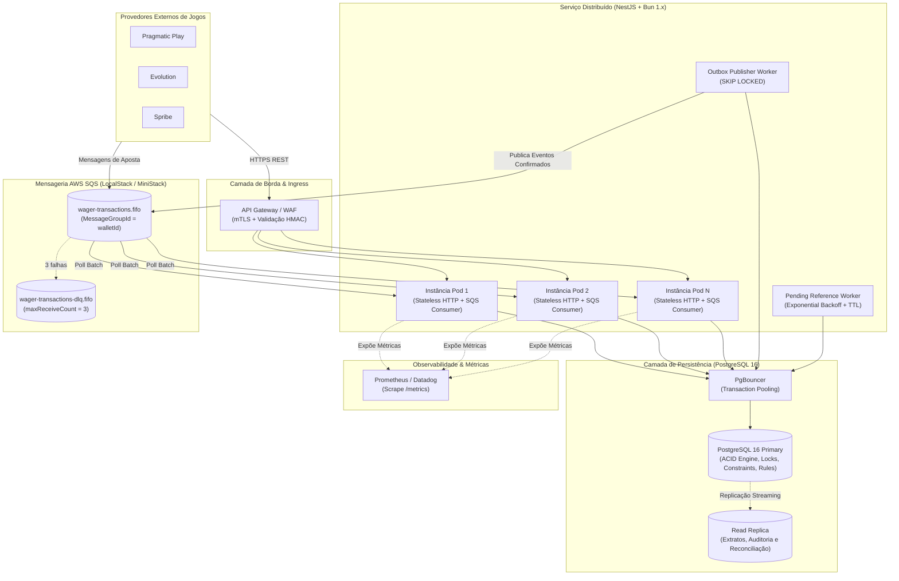
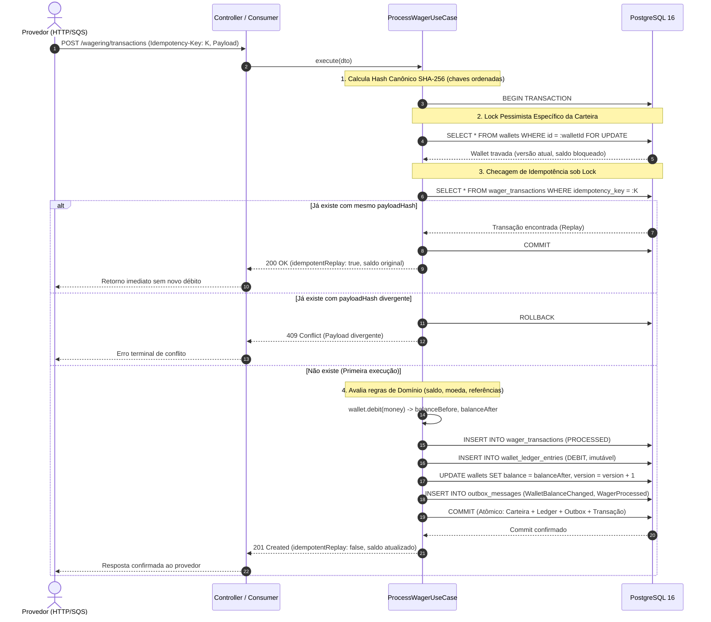
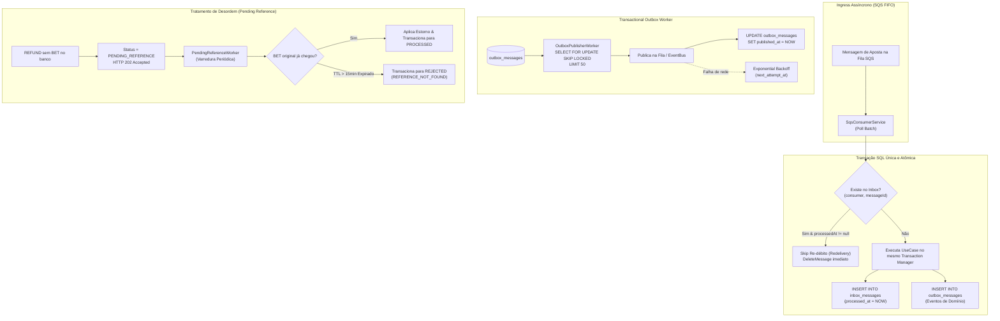
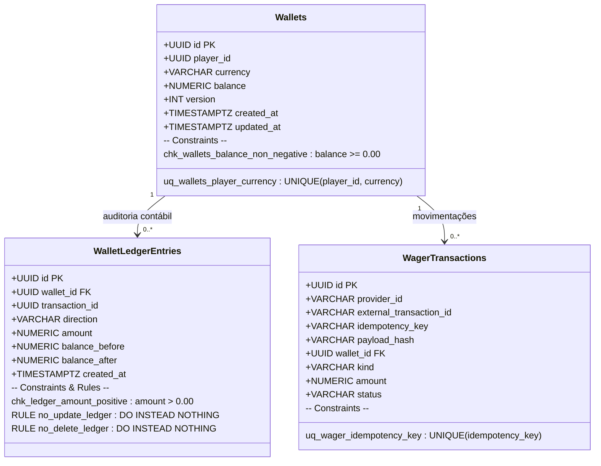
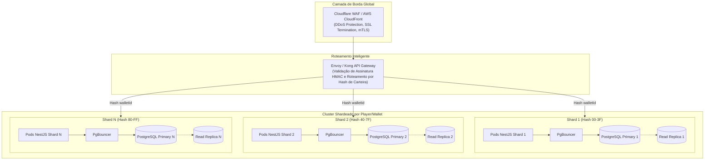

# Distributed Wagering Processor — System Design & Architecture Specification

> **Especificação Técnica de Alto Nível: Topologia Distribuída, Concorrência, Resiliência e Estratégia de Escala**
> **Serviço:** Distributed Wagering Processor
> **Stack:** NestJS, Bun 1.x, PostgreSQL 16, AWS SQS FIFO, MikroORM

---

## 🧭 Índice do Documento

- [1. Contexto de Negócio & Invariantes Inegociáveis](#1-contexto-de-negócio--invariantes-inegociáveis)
- [2. Topologia Geral da Arquitetura Distribuída](#2-topologia-geral-da-arquitetura-distribuída)
- [3. O Fluxo de Escrita Transacional Atômico](#3-o-fluxo-de-escrita-transacional-atômico)
- [4. Análise de Concorrência: Lock Pessimista vs Lock Otimista](#4-análise-de-concorrência-lock-pessimista-vs-lock-otimista)
- [5. Pipeline Assíncrono, Inbox/Outbox e Crash Recovery](#5-pipeline-assíncrono-inboxoutbox-e-crash-recovery)
- [6. Defesa em Profundidade no Banco de Dados (PostgreSQL)](#6-defesa-em-profundidade-no-banco-de-dados-postgresql)
- [7. Estratégia de Escala & Capacity Planning (50.000+ RPS)](#7-estratégia-de-escala--capacity-planning-50000-rps)
- [8. Observabilidade, Métricas e Comprovação Experimental](#8-observabilidade-métricas-e-comprovação-experimental)
- [9. Trade-offs Assumidos & Evolução para Produção](#9-trade-offs-assumidos--evolução-para-produção)
- [10. Decisões Arquiteturais Fundamentais (Architecture FAQ)](#10-decisões-arquiteturais-fundamentais-architecture-faq)

---

## 1. Contexto de Negócio & Invariantes Inegociáveis

### O Desafio
Em plataformas de iGaming, múltiplos provedores externos de jogos (ex: Pragmatic Play, Evolution, Spribe) disparam operações financeiras em tempo real associadas a rodadas de apostas:

$$\text{BET} \longrightarrow \text{WIN} \mid \text{LOSS} \mid \text{REFUND} \mid \text{ROLLBACK}$$

A comunicação ocorre sobre redes públicas não confiáveis com entrega **at-least-once**. Portanto, o sistema assume como premissas de projeto:
1. Mensagens serão **duplicadas** por retries automáticos de rede;
2. Mensagens chegarão **fora de ordem** (ex: um `REFUND` chegando antes da `BET` original);
3. Centenas de requisições concorrentes disputarão a **mesma carteira no mesmo milissegundo**;
4. Falhas e crashes de nós ocorrerão a qualquer momento (antes ou depois do commit transacional).

### As 4 Invariantes Globais Inegociáveis
1. **Saldo Nunca Negativo:** Nenhuma aposta ou reversão pode deixar a carteira abaixo de zero.
2. **Zero Duplicações:** Nem créditos nem débitos podem ser computados mais de uma vez.
3. **Imutabilidade Contábil Absoluta:** O saldo materializado da carteira é auditável e decorre estritamente do somatório do ledger (*append-only*):
   $$\text{wallet.balance} = \sum \text{ledger\_entries}$$
4. **Precisão Numérica Exata:** Proibição de ponto flutuante binário IEEE 754; manipulação decimal exata com 2 casas decimais via Value Object `Money` (`Decimal.js`).

---

## 2. Topologia Geral da Arquitetura Distribuída



### Componentes Chave da Topologia
- **Instâncias Stateless (Horizontalmente Escaláveis):** Os nós de aplicação não retêm estado em memória; qualquer réplica atende qualquer provedor ou carteira.
- **PgBouncer:** Camada de pooling de conexões que preserva o PostgreSQL contra exaustão de conexões durante rajadas de tráfego.
- **Duplo Canal de Entrada:** Suporte integrado a chamadas síncronas (REST) e assíncronas (SQS FIFO), ambas convergindo para o mesmo caso de uso transacional.

---

## 3. O Fluxo de Escrita Transacional Atômico



---

## 4. Análise de Concorrência: Lock Pessimista vs Lock Otimista

### Comparativo Técnico

| Critério | Optimistic Locking (`version`) | Pessimistic Locking (`SELECT FOR UPDATE`) |
|---|---|---|
| **Mecanismo** | `UPDATE WHERE version = v` | `SELECT ... FOR UPDATE` no início da transação |
| **Comportamento em Hot Wallet** | 50 requisições simultâneas: **1 passa e 49 falham** com exceção de concorrência. | 50 requisições simultâneas: **todas são enfileiradas e processadas** em ordem estrita. |
| **Overhead de CPU e Banco** | Exige loops de retry que sobrecarregam o banco com transações abortadas. | Transação única e determinística; locks duram frações de milissegundo. |
| **Isolamento de Concorrência** | Falha sob alta contenção na mesma linha. | **Cirúrgico por linha:** travar a carteira do Jogador A não bloqueia a carteira do Jogador B. |
| **Aderência ao Domínio de iGaming** | Frágil para apostas rápidas consecutivas (crash games, slots). | **Determinístico e consistente** sob concorrência pesada. |

$$\text{Granularidade do Lock} = \text{Chave Primária } \texttt{walletId} \implies \text{Concorrência Máxima Entre Carteiras Distintas}$$

---

## 5. Pipeline Assíncrono, Inbox/Outbox e Crash Recovery



### Garantias do Pipeline Assíncrono
1. **Crash Pós-Commit e Pré-Ack:** Se o nó morrer após o commit do banco mas antes de confirmar no SQS, a mensagem reaparecerá na fila. Ao ser re-entregue, a tabela `inbox_messages` acusa que a mensagem já foi processada, descartando o re-débito e deletando a mensagem da fila com segurança.
2. **Escalabilidade Concorrente na Outbox:** O uso de `SKIP LOCKED` permite que múltiplas réplicas do `OutboxPublisherWorker` processem lotes em paralelo sem conflito de locks entre si.

---

## 6. Defesa em Profundidade no Banco de Dados (PostgreSQL)



### Regras PostgreSQL de Imutabilidade do Ledger
```sql
-- Garante append-only estrutural a nível de engine
CREATE RULE no_update_ledger AS ON UPDATE TO wallet_ledger_entries DO INSTEAD NOTHING;
CREATE RULE no_delete_ledger AS ON DELETE TO wallet_ledger_entries DO INSTEAD NOTHING;
```

---

## 7. Estratégia de Escala & Capacity Planning (50.000+ RPS)



### Pilares de Escalabilidade
1. **Sharding por Hash de `walletId`:** Como cada aposta acessa estritamente uma única carteira, particionar o banco por hash elimina qualquer contenção entre shards. Cada shard processa 10.000 RPS de forma independente.
2. **Segregação de Leituras:** Operações de consulta pesada (`GET /wallets/:id/ledger` com paginação opaca) e reconciliação rodam em **Read Replicas**, poupando a CPU do nó primário para as escritas transacionais de apostas.
3. **Persistência Exclusiva de Saldo:** Em processamento financeiro de apostas, cache de saldo em Redis cria risco de *split-brain* e inconsistência eventual. O saldo é materializado exclusivamente no banco relacional sob controle transacional ACID.

---

## 8. Observabilidade, Métricas e Comprovação Experimental

### As 7 Métricas Obrigatórias Expostas em `/metrics`
1. `wagering_transactions_total{status}` (Contador por status de transação);
2. `wagering_duplicates_detected_total` (Contador de replays idempotentes);
3. `wagering_retries_total{component}` (Retries de outbox e mensageria SQS);
4. `wagering_dlq_messages_total` (Mensagens direcionadas à DLQ);
5. `wagering_lock_conflicts_total` (Contenções ou esperas de lock);
6. `wagering_outbox_lag_seconds` (Gauge de atraso da outbox);
7. `wagering_processing_latency_ms` (Sumário com percentis $p50$, $p95$, $p99$).

### Evidências Experimentais Obtidas no Projeto

```text
┌───────────────────────────────────────────────┬────────────────────────────┐
│ Validação Realizada                           │ Resultado Obtido           │
├───────────────────────────────────────────────┼────────────────────────────┤
│ Suíte de Testes Automatizados (bun test)      │ 131 testes / 100% aprovado │
│ Teste End-to-End no Servidor (test:e2e)       │ 19 de 19 passos aprovados  │
│ Teste de Carga Local (test:load)              │ 182.06 RPS (0% de erro)    │
│ Latência Mediana (p50) sob Carga Concorrente  │ 51.25 ms                   │
│ Latência de Pico (p99) sob Carga Concorrente  │ 162.55 ms                  │
│ Teste de Caos & Vetores de Ataque (test:chaos)│ 6 de 6 ataques bloqueados  │
│ Divergências Contábeis Detectadas             │ 0.00 BRL (100% consistente)│
└───────────────────────────────────────────────┴────────────────────────────┘
```

---

## 9. Trade-offs Assumidos & Evolução para Produção

### Trade-offs de Arquitetura
1. **Lock Pessimista vs Vazão Máxima em uma Única Carteira:**
   - *Decisão:* Priorizada consistência financeira absoluta. O throughput sequencial para uma **mesma carteira individual** é limitado pela latência de escrita no disco (~100-200 ops/s por jogador específico), margem superior ao comportamento humano real de apostas.
2. **Moeda Única em Carteira:**
   - *Decisão:* Uma carteira possui moeda imutável fixada na abertura. Para operar em outra moeda, instancia-se uma carteira correspondente para o mesmo `playerId`.
3. **Autenticação Desacoplada via Porta:**
   - *Decisão:* Criado o ponto de extensão limpo `ProviderIdentityPort` e `ProviderAuthGuard`, desacoplando a integração com IdPs externos (Keycloak, Zitadel, Cognito) do núcleo de domínio financeiro.

### Próximos Passos de Produção ("Day 2 Operations")
- **WAF & mTLS:** Configuração de mTLS nos endpoints com certificados X.509 por provedor de jogos.
- **OpenTelemetry Tracing:** Adição de trace spans distribuídos unificando logs de gateway, NestJS e banco de dados.
- **Double-Entry Bookkeeping Completo:** Expansão do ledger para partidas dobradas com contas de contrapartida da casa (*House Vault*).

---

## 10. Decisões Arquiteturais Fundamentais (Architecture FAQ)

### Q1: Por que utilizar Lock Pessimista no banco em vez de Lock Otimista com versionamento?
**Racional:**
Lock Otimista é indicado para cenários de baixa contenção. Em iGaming, operações de apostas em *hot wallets* geram rajadas de alta colisão na mesma carteira. Com lock otimista, sob 50 requisições simultâneas, 49 falhariam com `OptimisticLockException` e exigiriam loops de retry que saturam CPU e conexões. O lock pessimista (`SELECT FOR UPDATE`) isola a linha da carteira por frações de milissegundo, serializando as operações com custo mínimo e zero retries desnecessários.

---

### Q2: Como o sistema se recupera de um crash pós-commit e pré-ack no SQS?
**Racional:**
O problema é mitigado pelo padrão **Transactional Inbox**: o registro na tabela `inbox_messages` ocorre dentro da mesma transação SQL da aposta. Quando o processo reinicia ou o SQS entrega a mensagem novamente após expirar a visibilidade, o consumidor consulta `inbox_messages`. Ao detectar que o registro possui `processed_at` preenchido, o processamento de negócio é ignorado (sem re-débito) e o `deleteMessage` é executado no SQS.

---

### Q3: Por que não utilizar cache Redis para armazenar o saldo da carteira?
**Racional:**
Em processamento financeiro de apostas, cache em memória para saldo introduz risco de *split-brain*. O Redis não compartilha a mesma transação ACID do PostgreSQL. Se a atualização do cache divergir da persistência ou se réplicas concorrentes atualizarem o cache fora de ordem, o saldo desincroniza do ledger contábil, abrindo brecha para saques a descoberto. O saldo é mantido estritamente no banco relacional sob controle transacional ACID.

---

### Q4: Como é evitado o duplo débito em requisições paralelas com a mesma Idempotency-Key?
**Racional:**
A defesa opera em dupla camada: primeiro, o lock pessimista da carteira é adquirido antes da checagem de idempotência, serializando a verificação. Segundo, a coluna `idempotency_key` possui uma constraint UNIQUE no PostgreSQL. Se uma requisição tentar inserir em paralelo, ela é barrada pelo código de erro `23505` do banco, capturada defensivamente no caso de uso e retornada como o replay original com HTTP 200 e `idempotentReplay: true`.

---

### Q5: Como o sistema trata um REFUND entregue antes da BET referenciada?
**Racional:**
A transação é aceita com status `PENDING_REFERENCE` e respondida com **HTTP 202 Accepted**. O worker assíncrono `PendingReferenceWorker` monitora essas operações com backoff exponencial. Assim que a BET principal é persistida no banco, o worker detecta a referência e processa o estorno. Se a referência não chegar dentro do TTL de 15 minutos, a transação é transicionada para `REJECTED` por `REFERENCE_NOT_FOUND` de forma auditável.

---

### Q6: Qual é a estratégia de escala para suportar 100.000 apostas por segundo?
**Racional:**
A aplicação é 100% stateless, escalando horizontalmente via réplicas de pods. No banco de dados, como a unidade de concorrência é a `walletId`, aplica-se sharding horizontal particionando por hash de `walletId`. Não existem transações distribuídas entre carteiras diferentes, permitindo que cada shard processe de forma isolada. Consultas de extrato e reconciliação rodam em Read Replicas, e o PgBouncer atua no pooling de conexões.
