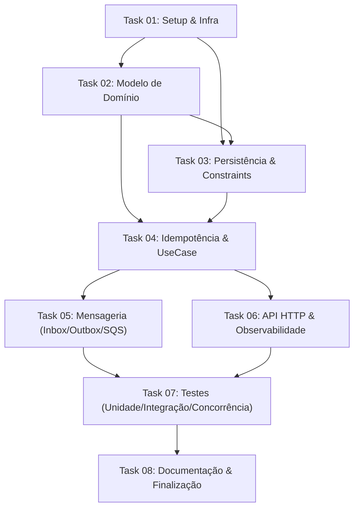

# Distributed Wagering Processor — Plano de Implementação

> **Projeto:** Distributed Wagering Processor (Technical Challenge — Jungle Gaming)  
> **Objetivo:** Construção de um motor financeiro distribuído de alta concorrência para iGaming com tolerância a falhas, consistência estrita, ledger imutável e idempotência comprovada.  
> **Nota Alvo:** 100/100 pontos + Diferenciais.

---

## 1. Visão Geral da Arquitetura

O sistema adota os princípios de **Clean Architecture**, **Domain-Driven Design (DDD)** e **Event-Driven Architecture (EDA)**, desacoplando o núcleo de negócio das camadas de infraestrutura, mensageria e persistência.

```
                  ┌────────────────────────────────────────┐
                  │          Provedores de Jogos           │
                  └───────────────┬────────────────────────┘
                                  │
                   ┌──────────────┴──────────────┐
                   │                             │
                   ▼                             ▼
           [ HTTP REST API ]            [ AWS SQS FIFO ]
         Idempotency-Key Header      wager-transactions.fifo
                   │                             │
                   │                             ▼
                   │                   [ Transactional Inbox ]
                   │                     (Deduplicação / Ack)
                   │                             │
                   └──────────────┬──────────────┘
                                  │
                                  ▼
                   ┌─────────────────────────────┐
                   │   Wager Transaction UseCase │
                   │  (Orquestração Transacional)│
                   └──────────────┬──────────────┘
                                  │
                 ┌────────────────┴────────────────┐
                 ▼                                 ▼
       [ Wallet Aggregate Root ]        [ WagerTransaction ]
     - Lock Exclusivo por WalletId     - Máquina de Estados
     - Validação de Saldo/Invariantes  - Resolução de Referências
                 │                                 │
                 └────────────────┬────────────────┘
                                  │
                                  ▼
               ┌─────────────────────────────────────┐
               │    TRANSAÇÃO ATÔMICA POSTGRESQL     │
               ├─────────────────────────────────────┤
               │ 1. Update Wallet (Balance & Version)│
               │ 2. Insert WalletLedgerEntry (Append)│
               │ 3. Insert/Update WagerTransaction   │
               │ 4. Insert OutboxMessage             │
               │ 5. Insert InboxMessage (se via SQS) │
               └──────────────────┬──────────────────┘
                                  │ Commit
                                  ▼
                     [ Outbox Polling Worker ]
                  (SELECT ... FOR UPDATE SKIP LOCKED)
                                  │
                                  ▼
                   [ AWS SQS Integration Events ]
               (WagerTransactionProcessed, BalanceChanged)
```

---

## 2. Mapa de Pontuação vs. Tasks

O plano foi desenhado para cobrir integralmente cada um dos 100 pontos da avaliação da Jungle Gaming:

| Área de Avaliação | Pontos | Tasks Responsáveis | Foco Principal |
|---|---|---|---|
| **Correção Financeira** | 20 | [Task 02](./task-02-domain-model.md), [Task 03](./task-03-persistence-and-constraints.md), [Task 04](./task-04-idempotency-and-wager-usecase.md), [Task 06](./task-06-http-api-and-observability.md) | Value Object `Money`, precisão decimal exata, `WalletLedgerEntry` append-only, reconciliação `balance == sum(ledger)`, reversões |
| **Concorrência** | 20 | [Task 03](./task-03-persistence-and-constraints.md), [Task 04](./task-04-idempotency-and-wager-usecase.md), [Task 07](./task-07-testing-strategy.md) | Lock granular por `walletId` (Pessimistic `FOR UPDATE`), isolamento sem deadlocks, teste de 2 apostas simultâneas disputando saldo |
| **Idempotência** | 15 | [Task 04](./task-04-idempotency-and-wager-usecase.md), [Task 06](./task-06-http-api-and-observability.md) | Hash canônico JSON SHA-256, detecção de replay idêntico (`idempotentReplay: true`), rejeição de conflito de payload |
| **Mensageria e Falhas** | 15 | [Task 05](./task-05-inbox-outbox-sqs-messaging.md) | Transactional Outbox com `SKIP LOCKED`, Transactional Inbox, graceful shutdown (`SIGTERM`), worker para referências fora de ordem |
| **Modelagem e Arquitetura** | 10 | [Task 02](./task-02-domain-model.md), [Task 08](./task-08-architecture-doc-and-finishing.md) | Domínio rico sem dependências de framework, factories estáticas (`create`/`rehydrate`), Aggregate Root encapsulado |
| **Testes** | 10 | [Task 07](./task-07-testing-strategy.md) | Testes unitários puros, testes de integração reais (PostgreSQL + LocalStack em Docker), testes de concorrência com 50 threads e 3+ instâncias |
| **Observabilidade** | 5 | [Task 06](./task-06-http-api-and-observability.md) | Logs JSON estruturados (`correlationId`, `walletId`, etc.), métricas operacionais, health checks separados (`/live` e `/ready`) |
| **Documentação** | 5 | [Task 08](./task-08-architecture-doc-and-finishing.md) | `README.md` completo e executável, `ARCHITECTURE.md` aprofundado com justificativas e trade-offs |

---

## 3. Estrutura das Tasks de Implementação

O desenvolvimento está particionado em 8 tasks modulares e incrementais:

1. [**Task 01: Setup do Ambiente, Tooling e Infraestrutura**](./task-01-infra-and-setup.md)
   - Instalação e configuração do Bun 1.x, TypeScript strict, NestJS.
   - Docker Compose com PostgreSQL e LocalStack (SQS FIFO + DLQ).
   - Scripts de automação e scripts de inicialização de filas.

2. [**Task 02: Modelo de Domínio Puro (DDD)**](./task-02-domain-model.md)
   - Value Object `Money` (imutável, 2 casas decimais, `Decimal`).
   - Aggregate Root `Wallet` (invariantes, métodos `credit`/`debit`, `version`).
   - Entidade imutável `WalletLedgerEntry` com verificação `isBalanced()`.
   - Entidade `WagerTransaction` e sua máquina de estados (`PENDING`, `PROCESSED`, `REJECTED`, etc.).
   - Hierarquia tipada de eventos de integração (`IntegrationEvent<T>`).

3. [**Task 03: Persistência, Migrações e Constraints de Banco**](./task-03-persistence-and-constraints.md)
   - Configuração do MikroORM (PostgreSQL) com suporte a transações e `LockMode`.
   - Tipos customizados para `Money` no ORM.
   - Migrations SQL versionadas com constraints rígidas: `CHECK (balance >= 0)`, `UNIQUE(player_id, currency)`, etc.
   - Repositórios tipados desacoplados por interfaces.

4. [**Task 04: Motor de Idempotência e Caso de Uso Transacional**](./task-04-idempotency-and-wager-usecase.md)
   - Serializador JSON canônico e algoritmo de hashing SHA-256.
   - `ProcessWagerTransactionUseCase`: orquestração financeira com lock pessimista na Wallet.
   - Regras de negócio completas: `BET`, `WIN`, `LOSS`, `REFUND`, `ROLLBACK`.
   - Taxonomia de códigos de falha (`FailureCode`).

5. [**Task 05: Mensageria Distribuída (Inbox, Outbox & SQS)**](./task-05-inbox-outbox-sqs-messaging.md)
   - Transactional Inbox com deduplicação por `(consumerName, messageId)`.
   - Transactional Outbox Poller concorrente (`SELECT ... FOR UPDATE SKIP LOCKED`).
   - SQS FIFO Consumer com ack pós-commit, retries exponenciais e DLQ.
   - Worker agendado para resolução de transações `PENDING_REFERENCE`.
   - Tratamento de `SIGTERM` (Graceful Shutdown).

6. [**Task 06: API HTTP REST, Reconciliação e Observabilidade**](./task-06-http-api-and-observability.md)
   - Endpoints HTTP REST (`POST /wallets`, `POST /wagering/transactions`, consultas com cursor opaco).
   - Endpoint de reconciliação financeira (`POST /wallets/:walletId/reconciliation`).
   - Endpoints de Health: `/health/live` e `/health/ready`.
   - Ponto de extensão para autenticação (`AuthGuard` / `ProviderIdentityPort`).
   - Logger estruturado JSON e métricas de sistema (Prometheus/custom).

7. [**Task 07: Bateria de Testes Automatizados (Unidade, Integração, Concorrência)**](./task-07-testing-strategy.md)
   - Testes unitários para `Money`, `Wallet` e regras de domínio.
   - Testes de integração com banco e LocalStack reais.
   - Testes de concorrência massiva (50 requisições simultâneas, hot wallet race condition, 3 instâncias).
   - Teste de carga e performance (`bun run test:load`).

8. [**Task 08: Documentação Arquitetural e Finalização**](./task-08-architecture-doc-and-finishing.md)
   - Elaboração do `ARCHITECTURE.md` detalhado (justificativas, decisões, trade-offs).
   - Atualização do `README.md` com instruções de reprodução local em um único comando.
   - Checklist de qualidade e validação final contra eliminatórias.

---

## 4. Ordem e Dependências de Execução



---

## 5. Critérios Globais de Aceite (Definition of Done)

Para qualquer task ser considerada concluída:
- [ ] TypeScript compila sem erros em modo estrito (`strict: true`, `noImplicitAny: true`, etc.).
- [ ] Não há nenhum uso de tipo numérico primitivo (`number`/`float`) para dinheiro no domínio.
- [ ] Migrations do banco de dados são reversíveis (`up` e `down` funcionais).
- [ ] Testes unitários e de integração relevantes passando no Bun test runner.
- [ ] Logs JSON estruturados sem vazamento de dados sensíveis.
- [ ] Invariante final respeitada: `wallet.balance == sum(ledger_entries)`.

